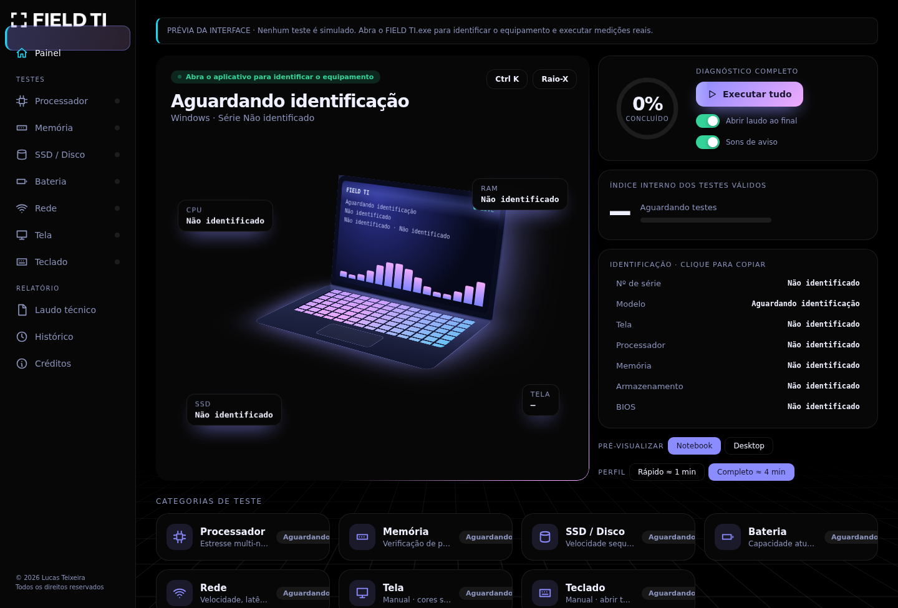
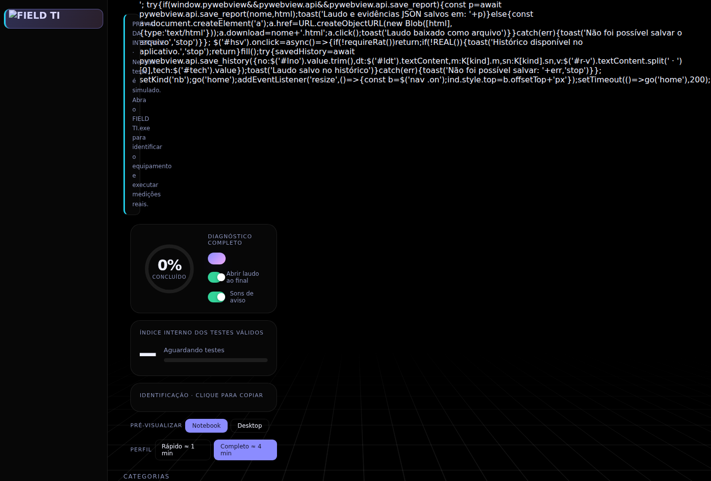
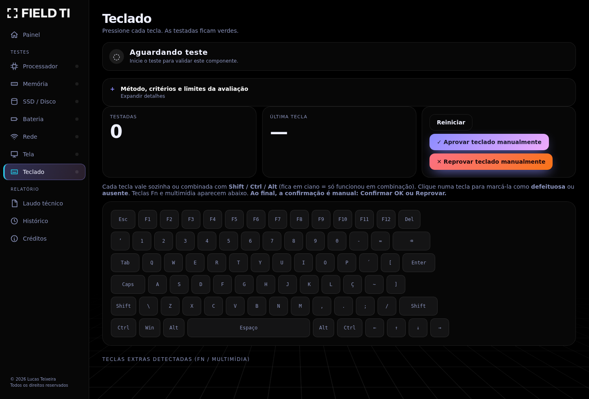

# FIELD TI

O FIELD TI é um aplicativo portátil de diagnóstico para técnicos de campo. Ele reúne testes de hardware e conectividade em um único atendimento e gera um laudo com as medições que sustentam cada resultado.

**Autor** · Lucas Teixeira  
**Distribuição** · 1.3.7 para Windows 10 e 11 x64

[Baixar para Windows x64](https://github.com/txrlucas7/field-ti/raw/refs/heads/main/FIELD_TI_1.3.7.exe) · [Como usar](#como-usar) · [Bancadas](#o-que-o-aplicativo-mede) · [Validação](#validação)

## O aplicativo por dentro

Prévia da interface da versão 1.3.7. Os valores exibidos na apresentação são ilustrativos.

<strong>Ver a bancada de SSD e disco</strong>

A bancada reúne leitura, escrita e integridade do arquivo de teste.

<strong>Ver a avaliação do teclado</strong>

O técnico acompanha as teclas acionadas e registra a avaliação ao final.

## Como usar

1. [Baixe o executável para Windows x64](https://github.com/txrlucas7/field-ti/raw/refs/heads/main/FIELD_TI_1.3.7.exe) ou extraia o ZIP do repositório. Execute `FIELD_TI_1.3.7.exe`. O Python já está incluído. A interface utiliza Microsoft Edge WebView2 Runtime e .NET Framework 4.8.
2. Selecione o perfil rápido ou completo. Execute uma bancada ou o diagnóstico completo. Para tela e teclado, registre a avaliação manual.
3. Informe a RAT e salve o laudo. O HTML e o JSON de evidências ficam em `Documentos\FIELD TI - Laudos`.

## O que o aplicativo mede

| Bancada | Evidência coletada |
|---|---|
| CPU | Temperatura, carga e desempenho durante o teste. A carga depende da disponibilidade do sensor. |
| RAM | Volume de memória alocado, padrões concluídos e divergências encontradas na amostra. |
| SSD ou disco | Volume testado, leitura, escrita e comparação de um arquivo temporário, além dos dados SMART expostos pelo Windows. |
| Rede | Conexão ativa, DNS, latência, download e upload. Uma transferência que falhou pode ser repetida e registrada no laudo. |
| Bateria | Capacidades de projeto e atual, saúde calculada e amostras, conforme os dados do equipamento. |
| Tela e teclado | Ciclo de cores, teclas acionadas e confirmação do técnico. |

## Organização do projeto

A interface em HTML, CSS e JavaScript está em `interface/index.html`. A execução das bancadas usa o backend Python integrado ao executável via pywebview, com consultas ao Windows, PowerShell e sensores. Esta distribuição inclui a interface editável, o binário portátil, o roteiro de validação e os avisos de terceiros. O código-fonte completo de compilação do backend não acompanha esta edição.

## Validação

Execute `VALIDAR_WINDOWS.cmd` para conferir o carregamento do pacote e registrar os resultados observados no computador de bancada. Ao concluir, a janela mostra o caminho do registro. O fluxo do GitHub Actions também confere o hash, inicia o executável em modo de autoteste e verifica o manifesto em um runner Windows.

Os cenários controlados abrangem transferência HTTPS local, falta de arquivo na preparação TLS, certificado inválido, repetição de transferência, contadores de SSD ausentes ou positivos e RAM com cobertura parcial. A homologação física exige medições em equipamento real. Laudos podem conter nomes, números de série e dados de atendimento. O pacote de publicação contém somente os arquivos do projeto.

## Créditos

Idealização, desenvolvimento e design por Lucas Teixeira. Os avisos sobre componentes externos estão em `LICENCAS_TERCEIROS.txt` e na distribuição do aplicativo.
